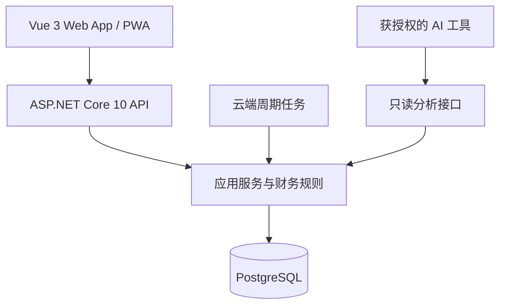

# 资产管家 · 应用形态与技术选型 V1.0

选型日期：2026-10-20；归档日期：2026-10-21。

本轮结论：手机优先的 Web App / PWA；前端采用 Vue 3 + TypeScript + Vite；后端采用 ASP.NET Core 10 Web API。云端正式账本采用 PostgreSQL，使用 EF Core 10 与对应 Npgsql Provider 访问。

用户已接受首版 Web App / PWA 方向，并明确后端采用 .NET、委托选择前端框架。本文记录开发基线；仓库初始化用于归档设计与原型，不代表前后端工程、依赖、云端资源或正式应用已经就绪。

## 1. 目标与约束

- 个人使用，以日常记账、资产观察和投资记录为核心；覆盖现金、基金、公积金和平台积存金。
- 本阶段以 iPhone 录入和查看体验为主；Mac 浏览器沿用手机布局，共用同一份云端账本。独立桌面布局留待后续评估。
- 保留既有产品业务规则与瓷白、克莱因蓝视觉设计，不在选型时扩大业务范围。
- 自动记账在云端运行，页面关闭后仍可执行。
- AI 可通过授权接口读取结构化账本；外部信息采集与截图识别通过服务端接入。
- 控制个人长期维护成本，保持清晰的业务边界和必要验证。

产品依据：[产品设计 V1.0](../product/资产管家-产品设计文档-V1.0.md)、[原型说明](../../prototype/README.md)和[UI 配色规范](../design/UI配色规范.md)。当前原型是静态演示，不能视作正式系统基础能力已经实现。

## 2. 应用形态

采用适配手机屏幕的单页应用（SPA），提供 PWA 安装入口。手机端沿用已确认的信息架构，本阶段只迭代手机版本；电脑浏览器沿用手机画幅，不将独立桌面宽屏布局纳入本阶段开发与验收。

iPhone 支持添加到主屏幕，安装、键盘、安全区域、返回导航和更新体验需在真实设备上验证。后续如需 Mac 独立窗口，可利用受支持系统上的 Safari 添加到 Dock 能力，另行评估桌面体验。

首版联网保存正式记录。PWA 优先缓存静态资源，服务端响应成功后才显示入账成功；不承诺完整离线账本、自动离线提交或多端离线冲突合并。账本 API、图片、备份不进入默认静态资源缓存。应用更新采用提示后更新，避免编辑中强制刷新。

## 3. 前端选择及取舍

| 方案 | 判断 |
| --- | --- |
| Vue 3 + TypeScript + Vite | 采用。组件模板、响应式状态和官方配套工具适合以表单、列表、图表为主的个人应用。 |
| React + TypeScript + Vite | 可行。若已有 React 经验或需要复用现成 React 代码，也值得选择；本项目尚无此约束，采用 Vue 的配套组合即可。 |
| Blazor | 可行，能使用 C# 编写界面；本项目优先使用 Vue 的移动端 Web 组件和交互工具链，后端继续发挥 .NET 优势。 |

这是针对本项目的维护与交付判断，不主张 Vue 在所有项目中优于 React 或 Blazor。未来增加原生客户端时可复用后端契约；Web 界面不能假定可以直接转换为原生界面。

确定的前端组合：

| 职责 | 选择 | 使用边界 |
| --- | --- | --- |
| 界面框架 | Vue 3，Composition API，单文件组件 | 使用 `<script setup lang="ts">` |
| 类型与构建 | TypeScript 严格模式 + Vite | 初始化时核对互相兼容的稳定版本并锁定依赖 |
| 路由 | Vue Router | 管理页面、返回路径和登录访问 |
| 客户端共享状态 | Pinia | 管理会话展示、筛选等状态；正式账本以服务端为准 |
| 基础移动端组件 | Vant 4 | 按需使用表单、弹层、选择器、数字键盘等；按现有设计覆盖主题 |
| 产品样式 | CSS 变量 + 组件局部 CSS | 延续现有语义色；资产卡片和手机页面按产品设计实现 |
| 图表 | Apache ECharts | 按需加载；日期、金额和状态同时提供文字或明细 |
| PWA | vite-plugin-pwa | 明确配置缓存与更新策略；不使用默认缓存替代账本存储 |
| API 调用 | 浏览器 fetch + 统一请求层 | 根据 OpenAPI 维护或生成类型化客户端；统一处理错误和会话失效 |
| 验证工具 | Vitest + Vue Test Utils；Playwright | 关键组件与业务交互测试；iPhone PWA 另做真实设备验证 |

Vant 用作基础能力，整体视觉服从产品设计。本阶段围绕手机页面实现，不引入桌面 UI 库；后续独立桌面布局可在相同业务与路由基础上扩展。首版没有公开内容收录需求，采用 SPA 即可，不引入 Nuxt 或 Next.js 的服务端渲染运行时。

## 4. 后端与正式数据

| 职责 | 选择 |
| --- | --- |
| 平台 | .NET 10 LTS，持续安装受支持补丁 |
| HTTP 框架 | ASP.NET Core 10 Web API，使用 Controllers |
| 组织方式 | 分层单体：API、应用服务、领域规则、基础设施 |
| 数据访问 | EF Core 10 + Npgsql Entity Framework Core Provider 10 |
| 正式数据库 | 云端 PostgreSQL；具体受支持版本在部署选型时确定 |
| 接口描述 | ASP.NET Core OpenAPI |

首版直接使用 ASP.NET Core，自行保持必要分层，不引入 ABP 的完整平台能力。当前没有多租户、组织管理和复杂权限平台的产品需求，采用这一组合可减少框架配置及升级面。这是本项目的选型判断，不改变用户其他项目使用 ABP 的习惯。

账本事实、现金联动、持仓状态、去重和历史更正统一由后端处理；金额使用精确十进制。前端展示与预览不能成为财务计算的唯一依据。单次业务的关联变更在事务中完成。

定时任务运行在云端，并持久化计划期次、执行状态和去重标识。任务框架属于后续实现设计，不影响本轮框架选择。

## 5. 前后端边界与部署组织

前后端源码分离，使用 HTTPS JSON API 通信；生产环境优先同域部署，前端静态资源与 `/api` 共用入口。可以由 ASP.NET Core 提供构建后的静态文件，也可以在同域网关后分开托管，部署供应商另行选择。

个人账本必须经过认证和授权访问；认证实现、云服务商、图片对象存储、任务框架、行情与识别服务在后续专项设计中确定。本轮不创建外部账户或基础设施。

## 6. AI 接入原则

- 先提供结构化导出与授权只读 API；有具体外部工具接入需求时再增加 MCP 适配。
- 数据同时提供业务日期、估值日期、来源和待确认状态，区分资产变化、生活收支和投资盈亏。
- AI 负责解释和分析；余额、成本和收益口径由业务服务确定计算。
- AI 分析只读访问，截图识别输出待核对草稿；正式写入复用经过校验的业务流程。
- 模型服务凭据留在服务端，不放进 Web 资源或客户端代码。

### 6.1 后续自然语言记账

已讨论后续接入 DeepSeek 等模型实现一句话记账，例如“我今天吃饭花了40”。此能力作为后续扩展记录，仍不纳入产品设计 V1.0 的首版必交范围，不提前增加语音或快捷指令入口。

模型由 .NET 服务端调用，输出类型、金额、币种、分类候选、业务日期和备注等结构化信息；相对日期按北京时间解析。后端校验后复用统一记账服务，沿用事务、防重和现金联动，不允许模型绕过业务服务直接修改账本。

首接入可采用解析后确认的流程；是否开放自动入账及其规则在该功能实施前确定。金额、日期或业务类型存在歧义时需补充信息；基金买入不能误记为生活支出。模型调用通过独立适配层封装，供应商和模型版本不进入核心账本规则。

## 7. 选型验证与实施边界

本轮已核对官方工具链资料、.NET 支持周期、Npgsql EF Core 10 文档与移动端组件项目资料，并核对现有原型的静态演示边界。

未安装或编译依赖，未运行集成测试，未执行浏览器或真实设备验收。Vue、Vite、TypeScript、Vant 与 PWA 插件的具体版本组合需在初始化时用锁文件固定，并以类型检查和生产构建确认兼容性。

后续实现的最低验证包括：关键记账流程、重复提交与事务回滚、资产联动、PWA 更新不丢表单、真实 iPhone 输入与返回体验、登录退出和备份恢复。独立桌面布局不纳入本阶段验收。按实际改动与现有覆盖安排测试，不为选型文档创建空测试。

## 8. 官方资料

- [Vue 工具链：Vite、TypeScript 与测试](https://vuejs.org/guide/scaling-up/tooling)
- [Vue Router](https://router.vuejs.org/)
- [Pinia](https://pinia.vuejs.org/introduction.html)
- [Vant 项目](https://github.com/youzan/vant)
- [Apache ECharts](https://echarts.apache.org/en/index.html)
- [Vite PWA](https://vite-pwa-org.netlify.app/guide/)
- [.NET 支持周期](https://dotnet.microsoft.com/en-us/platform/support/policy/dotnet-core)：2026-10-20 核实时，.NET 10 为 LTS，支持至 2028-11-14。
- [ASP.NET Core 10 OpenAPI](https://learn.microsoft.com/en-us/aspnet/core/fundamentals/openapi/overview?view=aspnetcore-10.0)
- [Npgsql EF Core Provider 10](https://www.npgsql.org/efcore/release-notes/10.0.html)
- [React 从零构建应用](https://react.dev/learn/build-a-react-app-from-scratch)
- [Apple：iPhone 网页应用](https://support.apple.com/en-asia/guide/iphone/iph42ab2f3a7/ios)
- [Apple：Mac 网页应用](https://support.apple.com/en-ca/104996)
