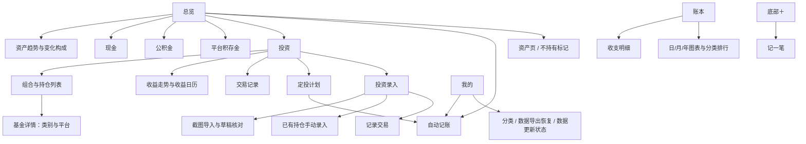
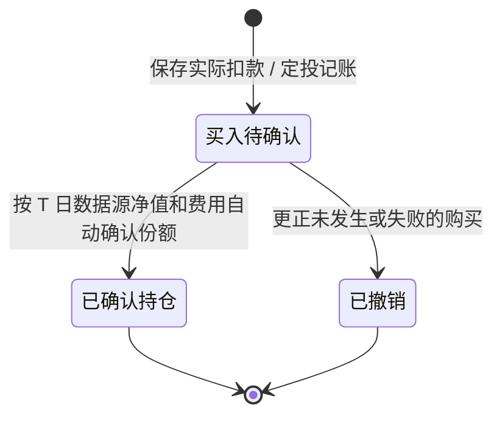
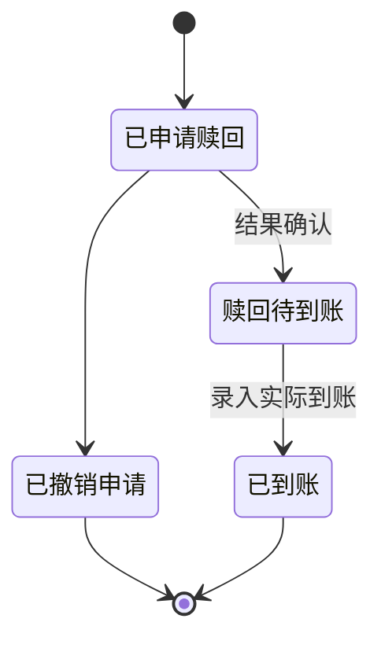
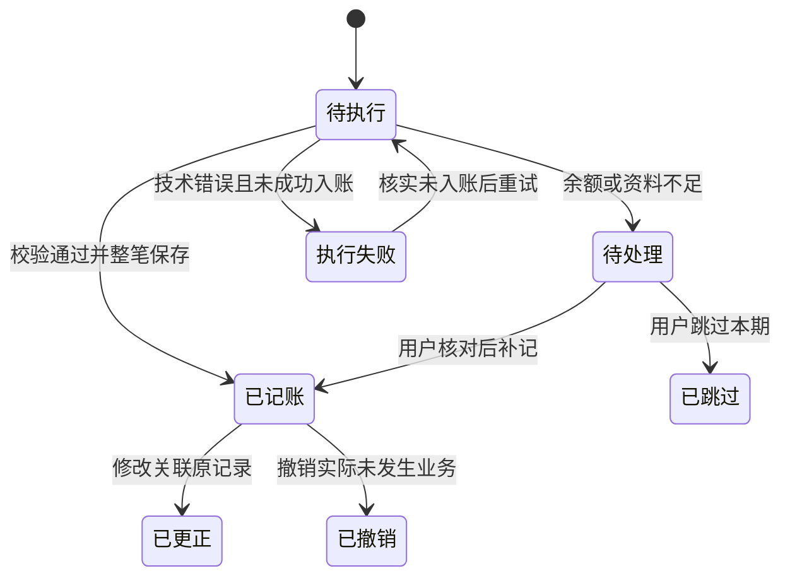
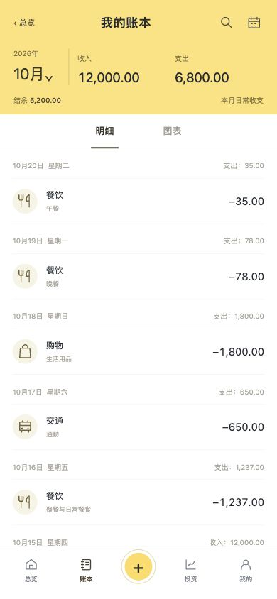
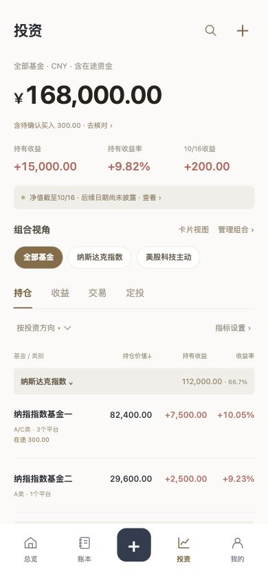
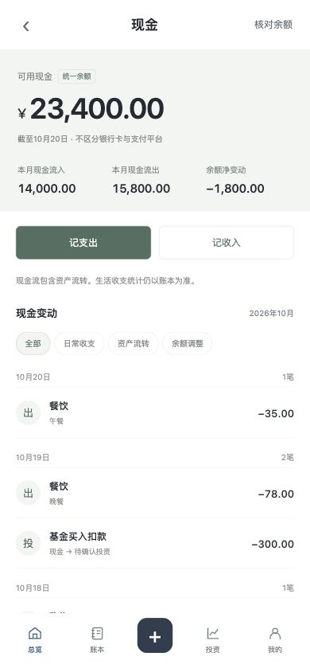
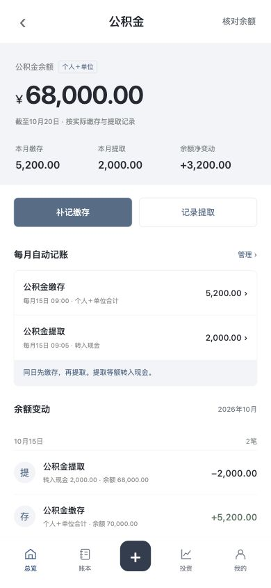
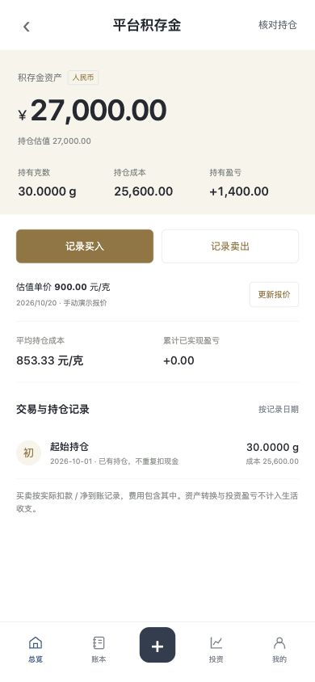
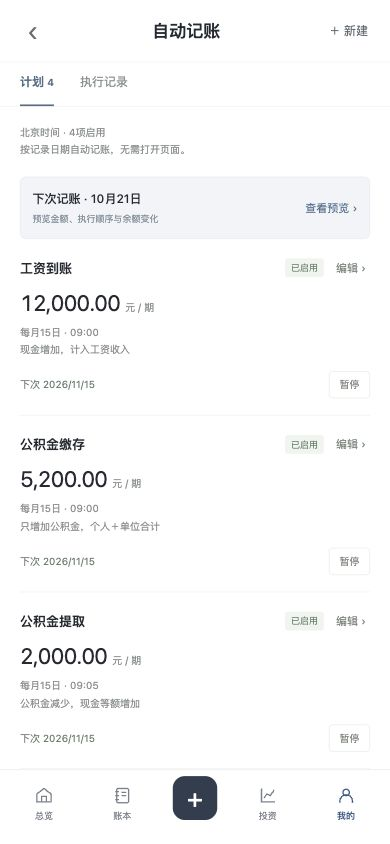

# 资产管家 · 产品设计文档

**版本：V1.2（基于 V1.1）　｜　整理日期：2026-10-26　｜　更新日期：2026-10-30　｜　形态：手机端 Web App**

**文档状态：已确认页面与核心业务规则的汇编。V1.1 已按实现版本同步首页口径、趋势范围、本月变化分解、五项主导航、计划分组与交易日历、积存金自动报价和公积金每月缴存；其余内容仍作为业务依据。**

本产品服务于个人资产观察和日常记账：用一个现金余额承接生活收支，把跨平台 QDII 基金、公积金、平台积存金和 A 股股票汇总到同一资产总览中，持续观察资产数量与走势，减少重复维护。

本文件描述目标产品与业务口径。实际功能进度以[功能迭代总览](../development/README.md)为准：持久化存储、行情接入、后台定时任务与导出恢复已实现并有自动化覆盖，截图识别尚未实现。交互线框仍是静态演示，数据为虚拟示例，操作刷新后重置。

### 修订记录

| 版本 | 日期 | 修订内容 |
| --- | --- | --- |
| V1.0 | 2026-10-20 | 首次整理：页面结构、术语口径、事件影响矩阵与验收场景 |
| V1.1 | 2026-10-26 | 按实现现状同步首页"已记录资产"与覆盖确认、趋势范围、本月变化分解、主导航结构；补充相应验收场景 |
| V1.1 修订 | 2026-10-27 | 同步五项底部导航、计划分组与整月交易日历、积存金自动报价与默认直接到账、公积金每月缴存并入缴存/提取表单，并把资产覆盖改为录入或标记不持有后自动判定 |
| V1.2 补充 | 2026-10-30 | 新增 A 股股票模块：多持仓、买入 / 卖出 / 持仓核对、行情与昨收、今日盈亏；股票纳入总资产、趋势、月度变化、覆盖、行情状态与备份 |

## 阅读与范围说明

- **已确认方案**：用户逐轮确认的页面结构、统一现金模式、用途分类记账、基金汇总与分组、公积金缴存及提取、积存金、A 股股票和自动记账计划。
- **本次规则细化**：为使上述方案可用于开发和验收，补充金额口径、状态转换、去重、更正、历史统计与异常处理。它们不代表已在交互线框中完整实现。
- **实施选型**：技术栈、部署方式、认证方案、行情和识别服务商、任务框架等，本文件仅规定能力与约束，不提前选定供应商或框架。
- 文中 **12,000 元工资、5,200 元公积金缴存、2,000 元提取、30 克黄金及2026年10月日期均为线框演示值**，不视作用户真实资产信息或不可修改的产品默认值。用户举例的每月提取2,000元应可在计划中调整。
- 原型只允许部分演示日期，不构成正式产品限制。正式产品支持建立账本后补录、查询和更正已有业务日期；尚未发生的事项使用计划或预览，不提前作为已发生流水。

## 目录

1. [目标、原则与首版范围](#1-目标原则与首版范围)
2. [信息架构与页面清单](#2-信息架构与页面清单)
3. [统一术语与统计规则](#3-统一术语与统计规则)
4. [首页：资产总览](#4-首页资产总览)
5. [账本：明细、图表与记一笔](#5-账本明细图表与记一笔)
6. [投资：组合、持仓与收益](#6-投资组合持仓与收益)
7. [投资录入、交易与定投](#7-投资录入交易与定投)
8. [现金](#8-现金)
9. [公积金](#9-公积金)
10. [平台积存金](#10-平台积存金)
11. [自动记账计划](#11-自动记账计划)
12. [初始化、核对与历史更正](#12-初始化核对与历史更正)
13. [数据对象与关联关系](#13-数据对象与关联关系)
14. [服务能力、数据保护与使用体验](#14-服务能力数据保护与使用体验)
15. [一致性示例](#15-一致性示例)
16. [验收场景](#16-验收场景)
17. [原型覆盖、实施选型与交付边界](#17-原型覆盖实施选型与交付边界)
18. [线框与资料索引](#18-线框与资料索引)

## 1. 目标、原则与首版范围

### 1.1 核心目标

| 目标 | 用户应能完成的事情 |
|---|---|
| 看清家底 | 打开首页即可看到现金、基金、公积金、积存金及资产趋势 |
| 顺手记账 | 选择用途分类、输入金额和日期，即可记一笔并同步现金 |
| 看清投资 | 将多个平台的 QDII 持仓归集，同基金 A/C 类汇总，不混合不同类别份额 |
| 减少重复维护 | 工资、缴存、提取和定投按计划记账，现金与相关资产联动 |
| 能对账和解释变化 | 分清生活结余、缴存、投资盈亏和核对差额；可追溯原始记录 |

### 1.2 已确认的设计取舍

| 决策 | 采用的方案 | 原因与约束 |
|---|---|---|
| 整体模式 | 参考轻松算身家的账本与资产联动 | 高频记账自然维护资产总览 |
| 账本与记一笔 | 参考鲨鱼记账 | 分类图标、数字键盘、按日明细、日/月/年统计 |
| 投资 | 参考持仓手记 | 跨平台归集、组合视角、自选指标、截图草稿核对 |
| 现金账户 | 仅维护一个现金池 | 不要求每笔选择银行卡、微信、支付宝或付款平台 |
| 平台信息 | 仅在投资持仓明细中保留 | 用于核对持仓来源，不扩展为多个生活现金账户 |
| 公积金 | 合并记录个人和单位缴存 | 同一余额，支持每月缴存与提取至现金 |
| 黄金 | 平台积存金 | 记录克数、成本、报价和买卖，不按实物首饰管理 |
| 自动任务 | 服务端周期记账 | 正式产品不依赖手机页面持续打开；仅做账面记录 |

### 1.3 首版包含

- 首页资产合计（四类资产均已录入或标记不持有后自动显示总资产）、资产分布、本月收支、资产趋势和近期自动计划。
- 收支分类、记一笔、历史修改、日/月/年汇总、趋势和分类排行。
- QDII 基金、同基金多份额类别、多平台持仓、投资方向分组。
- 手动录入已有持仓，截图识别后生成可编辑草稿并核对重复。
- 基金买入、确认、赎回与到账的记录流程，定投计划与现金联动。
- 现金余额及变动、公积金缴存及提取、积存金持仓及买卖。
- 工资、公积金缴存、公积金提取和基金定投四类计划，按基金定投 / 公积金 / 定期收入分组、执行记录、暂停及待处理期次。
- 基础对账、更正留痕、数据导出与完整备份恢复能力。

### 1.4 本次不扩展的范围

不建设真实支付或基金交易能力，不连接银行自动扣款，不维护多个生活支付账户，不加入房产、贷款、信用卡账单、家庭共享、预算、存钱目标、社交或投资建议模块。自然语言、语音记账与第三方快捷指令也不纳入本次已确认的录入流程。

首版以人民币计价的境内 QDII 份额为主要投资对象，不另建海外券商、外币现金与换汇系统。基金分红、份额拆分、基金转换等特殊事项未形成独立确认流程，处理边界见6.6节。

## 2. 信息架构与页面清单

主导航为 **总览 / 账本 / ＋记一笔 / 计划 / 我的** 五项，记一笔固定在底部导航中央。资产不再占用底部导航，从首页资产分布右上「管理」或各类资产行进入资产页与资产详情；「管理」同时维护公积金、基金和积存金的“不持有”标记。底部导航不承担资产买卖入口。



| 编号 | 页面 / 流程 | 核心入口 | 返回关系 |
|---|---|---|---|
| P01 | 首页资产总览 | 总览导航 | 一级页面 |
| P02 | 账本明细 | 账本导航、首页本月收支 | 一级页面 |
| P03 | 账本图表 | 账本“图表” | 保留所选周期与收支方向 |
| P04 | 记一笔 | 底部＋、首页“去记一笔”、现金记收支、流水编辑 | 取消回来源页；保存进入对应日期明细 |
| P05 | 投资总览 | 首页资产分布的基金行 / 资产页 | 一级页面 |
| P06 | 基金详情 | 持仓列表 | 回到原投资范围 |
| P07 | 投资录入 / 已有持仓 | 投资右上＋ | 返回投资 |
| P08 | 截图导入 / 草稿核对 | 投资录入 | 返回导入或投资 |
| P09 | 基金交易 / 确认 / 到账 | 录入、基金详情、交易页 | 返回交易或基金详情 |
| P10 | 现金 | 首页现金 | 返回总览 |
| P11 | 公积金 | 首页公积金 | 返回总览 |
| P12 | 平台积存金 | 首页积存金 | 返回总览 |
| P13 | 自动记账 / 执行记录 / 交易日历 | 计划导航、首页、我的、资产关联计划 | 返回来源；在“计划”下管理 |
| P14 | 我的 | 我的导航 | 一级页面 |
| P15 | 资产页 / 不持有标记 | 首页资产分布右上「管理」或资产行 | 返回总览 |

## 3. 统一术语与统计规则

### 3.1 资产与收支的边界

“总资产”表示本版四类资产的合计。本版没有负债模块，不将其称为已经扣除全部负债的“净资产”。

```text
总资产 = 统一现金余额 + 基金资产 + 公积金余额 + 积存金资产

基金资产 = 已确认份额估值 + 买入待确认资金 + 赎回待到账资金
积存金资产 = 持有克数 × 有效报价 + 卖出待到账资金

日常结余 = 日常收入 − 消费支出
```

在途或待到账款项仍有明确的资产归属，不因暂未确认或尚未收款而从总资产中消失。同一笔金额只能存在于一个资产状态中，不能同时计入现金与待确认、或持仓与待到账。

“已记录资产”与“总资产”是两个口径，不得混用：

| 口径 | 含义 | 使用条件 |
|---|---|---|
| 已记录资产 | 当前已录入并可计算的四类资产合计 | 仍有资产既未录入也未标记“不持有”时使用 |
| 总资产 | 完整四类资产的合计 | 四类资产均已录入或已标记“不持有”后自动可用 |

四类资产未全部录入且未全部标记“不持有”之前，页面只显示“已记录资产”，不出现“总资产”字样，也不以“缺失项按 0 计”冒充完整总额。自动判定规则见 4.1 与 12.1。

### 3.2 事件影响矩阵

下表中的“总资产影响”不包含交易之后的新行情变化。

| 业务事件 | 现金 | 其他资产 | 生活收支 | 总资产影响 |
|---|---|---|---|---|
| 消费支出 X | −X | 无 | 支出＋X | −X |
| 工资等日常收入 X | ＋X | 无 | 收入＋X | ＋X |
| 公积金缴存 X | 不变 | 公积金＋X | 不计入 | ＋X |
| 公积金提取 X | ＋X | 公积金−X | 不计入 | 0 |
| 基金买入扣款 X | −X | 买入待确认＋X | 不计入 | 0 |
| 基金买入确认 | 不再扣款 | 待确认转为份额估值 | 不计入 | 手续费、成交价与估值差额可产生变化 |
| 基金赎回确认 | 不变 | 减少份额，增加待到账 | 不计入 | 按净到账及费用反映差额 |
| 基金赎回到账 X | ＋X | 基金待到账−X | 不计入 | 0 |
| 积存金买入 X | −X | 增加克数与成本 | 不计入 | 当前估值与实际扣款的差额 |
| 积存金卖出待到账 X | 不变 | 减少克数，待到账＋X | 不计入 | 当前估值与实际净回款的差额 |
| 积存金卖出到账 X | ＋X | 积存金待到账−X | 不计入 | 0 |
| 行情 / 报价更新 | 不变 | 更新持仓估值 | 不计入 | 估值差额 |
| 起始资产录入 | 按起始值建立 | 按起始值建立 | 不计入 | 建立统计起点，不解释为收入或收益 |
| 余额 / 持仓更正 | 依更正对象 | 依更正对象 | 不自动计入 | 作为核对差额单列 |

### 3.3 日期、币种与精度

- 业务日期使用北京时间 `Asia/Shanghai`。记录业务发生日期，同时保留创建、修改、确认、到账和行情更新时间；这些时间不能相互替代。
- 日、月、年汇总按业务日期划分自然周期，不按记录创建时间划分。今天记一笔上月支出，应回到上月统计。
- 金额展示两位小数，人民币为统一汇总币种。金额和成本使用精确十进制计算，不使用二进制浮点累积财务余额。
- 基金份额与积存金克数通常展示四位小数；净值保留至少其来源提供的有效精度。计算时保留足够精度，最终金额按分舍入。
- 成本按比例结转时，最后一笔清仓结转全部剩余成本，避免残留几分钱；成本为0时收益率展示“—”，不除以0。
- 金额、份额、克数需为有效非负数；新增交易数量和交易金额必须大于0。核对余额允许为0。现金、公积金和可售份额不得因记录而变为负数。

### 3.4 首页变化构成

```text
本月变化 = 今天已记录资产 − 月初已记录资产（同口径）

分解为：
本月市值变动 + 本月净存入 · 转账

本月新增记录单列，不计入变化
```

比较只累加月初与今天都已记录的类别。本月新录入的类别单列为“新增记录”，不计入变化，避免把录入动作误解为收益。

现金和公积金只称余额变化，基金和积存金的市值变化才称收益。公积金提取、现金买入投资、卖出款转回现金是跨资产转移，不单独增加总资产。资产确认时的费用和价差纳入投资变化，不伪装成消费分类。

没有月初可比基线时，显示“自起始记录以来变化”及起始日期，不编造月初余额。

### 3.5 一次业务、同步更新

用户保存一次业务后，相关现金、资产、明细和统计应一起更新；失败时整笔不生效。双击保存、页面重试和任务重复触发均不能重复记账。

交易主记录是事实来源；多个页面只是查看同一记录。基金定投在投资页与自动记账页共用同一计划，不维护两份计划或生成两笔扣款。

## 4. 首页：资产总览

### 4.1 页面布局

按以下顺序呈现：

1. 资产合计金额（未覆盖完整资产时称“已记录资产”）、人民币标识、本月变化入口、数据更新日期。
2. 资产趋势图（同口径）。
3. 资产分布：按 **现金、基金、股票、公积金、积存金** 的固定顺序排列的比例条与统一行结构（比例条段落顺序与资产行一致）。
4. 本月收入、支出、结余，及查看账本入口。
5. 近期自动记账计划和异常处理入口。

资产行提供最少必要状态：现金为统一余额；基金注明包含在途金额；公积金显示本月缴存；积存金显示持有克数。点击进入对应页面。

资产覆盖：四类资产中，现金始终计入；公积金、基金和积存金可在资产页标记为“不持有”。当每类资产都已录入或已标记“不持有”时，首页与资产页自动把“已记录资产”升级为“总资产”，无需另行确认。仍有资产既未录入也未标记时，页面只显示“已记录资产”。有持仓的资产不允许标记为“不持有”；标记不持有不会删除已有记录，取消标记后恢复为待录入。

### 4.2 资产趋势

- 支持近7日、近1月、近3月、全部。首页趋势不设“今年”范围；投资收益走势的范围见 6.5 节。
- 只累计区间起点已记录的类别；某日新录入的类别在该日标为“新增”，不计入曲线，曲线在新增当天用虚线标记。
- 记录不足 7 天时显示紧凑进度状态，不画曲线。
- 点击或触摸日期点，显示对应日期与资产总额；默认查看最新有效日期。
- 数据依据该日的资产状态和当时有效行情形成。补记、撤销或更正历史记录后，受影响日期及后续余额需要重算。
- 尚未建立资产记录的日期不填0；初次导入当前持仓也不能自动生成导入前的真实走势。
- 最新基金净值晚于现金记录日期时，仍可显示按各资产最新有效值计算的总额，但须明确基金净值日期。该总额不称作实时清算金额。
- 行情晚披露时，保留“净值日期”和“取得时间”。后取得某历史日期净值，可以修正该日期之后的估值，不把取得时间当作收益发生日。

### 4.3 本月变化与自动计划

点击本月变化，展开市值变动、净存入 · 转账和新增记录。同口径类别各项之和必须与本月变化一致；本月新增记录的类别单列标注“不计入变化”。

自动记账按最近到期日展示；同一天的工资、缴存和提取可合并为多项计划入口，详情仍逐项列出。发生待处理项时，应在此提示类型、日期和处理入口，不只显示下一期正常计划。

## 5. 账本：明细、图表与记一笔

### 5.1 明细页

采用已确认的鲨鱼记账参考结构：顶部突出年份 / 月份及收入、支出、结余，下方切换“明细 / 图表”。

- 默认展示本月日常收支，按日期倒序分组，同日记录继续排序。
- 日期组展示当天收入与支出合计；每条显示分类图标、分类名、备注及带方向的金额。
- 自动生成的工资标记“自动记账”，但计入与手动工资相同的收入分类。
- 支持日、月、年周期选择及前后切换；支持日期定位、搜索与分类筛选。
- 点击流水查看或修改原记录。保存修改后同步现金和受影响周期统计。
- 公积金缴存、提取及投资买卖不混入生活明细，通过“查看资产变动”进入对应记录。

### 5.2 记一笔

主要路径：**选择支出 / 收入 → 选择用途分类 → 输入金额 → 完成**。

| 字段 / 控件 | 规则 |
|---|---|
| 收支方向 | 默认支出；现金页“记收入”直接进入收入模式 |
| 分类 | 支出和收入使用各自分类集合；不选择支付平台 |
| 金额 | 必填，大于0，精确到分 |
| 数字键盘 | 数字、小数点、删除、加、减、完成；支持简单加减表达式，保存计算结果 |
| 日期 | 默认今天，可补记过去日期；未来业务使用计划，不提前记为已发生 |
| 备注 | 选填，记录用途细节 |
| 取消 | 返回打开前页面，不产生记录或改变余额 |

支出示例分类：餐饮、购物、日用、交通、居家、服饰、娱乐、通讯、医疗、学习、运动、旅行、宠物、人情、其他。收入示例分类：工资、奖金、其他收入。

分类支持新增、编辑与排序；已有记录引用的分类不能直接消失，停用后历史记录仍可展示和统计。分类更名同步显示，记录类型保持不变。

保存支出时扣减现金，保存收入时增加现金。现金不足时提示核对余额，不保存一条无法完成现金联动的支出。

### 5.3 图表与精确汇总

- 支持收入 / 支出方向切换，支持日 / 月 / 年周期。
- 月视图按日绘制，年视图按月绘制，日视图显示当天金额；支持前后周期及日期选择。
- 显示周期总额、日均、趋势和分类排行；分类排行显示金额、占比和进度条。
- 点击分类回到相同周期、相同方向的原始流水；可清除筛选。
- 金额汇总和明细以分为单位一致，不因显示取整丢失小额记录。首页可紧凑展示，精确值仍应可查看。

日均的细化口径：当前月 / 年从该周期1日起算至今天；完整历史月 / 年按该自然周期天数计算；日视图分母为1。没有记录的已过去日期计入天数，未来日期不计入分母。账本在周期中途才建立且数据不完整时，展示统计覆盖范围，不暗示全周期完整。

## 6. 投资：组合、持仓与收益

### 6.1 投资总览

顶部包含总投资金额、待确认入口、持有收益、持有收益率、最近有效净值日期收益及更新状态。

中部为“组合视角”：全部基金及用户自定义分组，示例为“纳斯达克指数”“美股科技主动”。默认使用紧凑胶囊切换，也可切换卡片。下面包含 **持仓 / 收益 / 交易 / 定投** 四个视图。

切换分组后，总金额、指标、持仓、收益、交易及定投列表使用同一范围；不得仅过滤列表而保留全部基金的顶部合计。

### 6.2 基金、份额类别和平台

存储层次为 **投资分组 → 基金汇总实体 → 份额类别 → 原始平台持仓**。持仓页面只显示到份额类别，原始平台持仓保留供核对和历史追溯，不按渠道拆行。

- 同一只基金的 A、C 等类别分别保存基金代码、份额、成本和净值，可以按金额归到同一基金汇总实体。
- 不直接把 A 类份额和 C 类份额加成一个“总份额”，也不平均不同类别净值。
- 同类别按基金代码与类别跨平台汇总份额、金额、成本和盈亏；缺少代码时使用规范化名称与类别，并显示匹配依据。原始平台记录保留独立成本、余额和核对日期；未标类别不混入已知类别。
- 不同基金公司或不同产品的纳指基金，仍是不同基金；它们只在“纳斯达克指数”分组内合计，不能因跟踪相同指数而合并成同一基金。
- 同基金类别关系须核对，不能仅凭名称去掉“A/C”字符自动认定。
- 每只基金归入一个主分组；同基金的 A/C 类跟随该分组。移动分组不改持仓与资产总额，也不产生交易。
- 新持仓没有明确分组时进入“未分组”，仍计入全部基金，之后可以调整。

### 6.3 持仓列表与基金详情

列表支持按投资方向分组或同基金平铺、搜索基金，以及指标排序。手机端每次恰好选择3项指标，默认 **持仓价值 / 持有收益 / 收益率**。可选指标包含持仓成本、占比、待确认金额；最近净值日收益见收益视图。

基金详情先展示同基金汇总金额与收益，再展开 A/C 等类别，每类汇总显示份额、净值、净值日期、成本、估值、持有盈亏和已实现盈亏；不显示渠道分组。净值不求和、不平均，来源不一致时明确标注。每个原始平台持仓提供买入、赎回、刷新净值和调整份额快捷入口。净值只能通过基金数据源刷新，持仓录入也必须提供基金代码并获取数据源净值；份额核对生成可追溯的更正记录。

### 6.4 估值、成本和持有收益

```text
类别持仓估值 = 该类别已确认份额 × 该类别有效净值
基金已确认估值 = 各类别、各平台持仓估值合计

持有收益 = 已确认持仓估值 − 对应剩余持仓成本
持有收益率 = 持有收益 ÷ 对应剩余持仓成本

组合持有收益 = 组合内已确认持仓收益之和
组合持有收益率 = 组合持有收益 ÷ 组合剩余持仓成本
```

待确认金额计入投资资产，但不计入已确认持仓成本对应的收益率分母。组合收益率不是各基金收益率的算术平均数，也不将它称作年化收益或内部收益率。

原始买入支出包含实际手续费；买入确认时补齐实际份额、成交净值、费用和平台结果。份额 × 成交净值与扣款金额不一致时允许用费用等解释，不默默丢弃差额。赎回按对应类别、平台持仓的加权平均成本结转，记录净到账及相关费用。

### 6.5 收益走势、日期与日历

- 提供本月、近3月、今年、全部的走势与区间收益归属。
- 以实际净值日期归属收益；日历点击某天可查看该日各基金及合计。
- 尚未披露净值的日期显示“未披露”或“—”，不记为0收益；累计走势也不能据此伪造一段真实收益为0的记录。
- 汇总某日收益时，仅累加该日期已具备有效依据的项目；数据不完整时注明覆盖范围，不把不同基金的不同净值日收益混称为同一天完整收益。
- 已有持仓快照只能建立起点，不能恢复导入前的完整收益历史。缺少区间起点、交易、净值等依据时，对应区间显示资料不足，不生成精确累计收益或区间收益率。

本次细化规定：区间投资盈亏以投资资产期末值减期初值，扣除区间净转入及核对差额；买入、赎回到账等跨现金与投资的移动作为投资范围的资金流，不能被解释为收益。持有收益与区间盈亏可能不同，应使用各自名称。

### 6.6 特殊事项与完整性边界

本次没有确认基金分红、拆分、基金转换等独立录入页，也没有确认复杂收益率、同基准比较、回撤或投资建议。因此：

1. 首版不凭估计自动生成这些事件。
2. 出现特殊事项时，提供持仓与现金核对、原因备注，且将不完整历史区间标识出来。
3. 核对差额不自动归为投资收益；不能用一条余额修正假装已准确核算分红或转换。
4. 如需在首版完整覆盖这些事项，应在实现前单独补充设计；现有“持有收益”不能宣传为覆盖全部历史交易的累计投资回报。

## 7. 投资录入、交易与定投

### 7.1 先区分记录性质

| 录入类型 | 用途 | 是否再次扣现金 |
|---|---|---|
| 已有持仓快照 | 初始化、盘点、更新已有持仓 | 否 |
| 新买入记录 | 记录实际购买与扣款 | 是，且只扣一次 |
| 赎回 / 到账记录 | 记录卖出和回款状态 | 到账时才增加现金 |
| 定投计划 | 保存未来周期规则 | 保存计划本身不扣款 |

已有持仓表单包含基金及类别、平台、持有份额、持仓成本、截至日期和分组。平台按券商直销、支付宝、天天基金、银行四类选择；份额类别和确认周期由基金搜索自动识别，不单独展示。缺少必要成本或份额时保留草稿 / 待核对状态；没有有效计算依据的收益展示“—”。同基金、同类别、同平台已有记录时，保存前提示重复，由用户选择更新已有持仓（覆盖份额和成本）或新增独立持仓。

持仓快照仅描述截至日已确认持仓，买入待确认与卖出待到账另行保留，不被快照重复累加或清除。更新已有持仓时，须说明更新的对象和截至日期；早于已有后续交易的快照不能直接覆盖今天余额，应重算其后的交易，若当前能力无法可靠重算则保留草稿并提示核对。

### 7.2 截图导入

流程为 **选择多张截图 → 识别形成草稿 → 修改字段 → 检查重复 → 逐条核对 → 确认入账**。

- 支持按平台分别选择持仓截图，不要求预先拼图；手动录入始终作为替代入口。
- 识别结果先存草稿，不直接改变正式资产和现金。
- 核对基金身份、份额类别、平台、份额、成本、截至日期及分组；识别不确定的字段明确提示。
- 同基金、同类别、同平台已有记录时，默认提示重复，并选择“核对更新已有持仓”或明确确认另一笔独立持仓。
- 独立持仓须有独立记录标识与核对依据；不能把同一张截图再次导入直接累加。
- 每条草稿确认完成，且重复处理选择完整后，才允许整批提交；修改关键字段后重新核对。
- 重复点击提交、网络重试不会生成第二批资产。失败的批次保留草稿，说明失败原因。
- 导入成功不会再从现金扣除这些已有持仓成本。

### 7.3 买入状态与现金联动



保存扣款金额、实际申购费和下单日期时，现金减少、待确认投资等额增加，总资产保持不变。北京时间 15:00 前可撤销；15:00 整起不可撤销。15:00 前下单按当日为 T 日，15:00 起下单按下一开放交易日为 T 日；扣款仍按实际下单日入账。持仓默认 T+2 自动确认，基金可单独设置 T+1。确认使用数据源取得的 T 日净值，份额按 `(扣款金额 − 申购费) ÷ T 日净值` 计算，取四位小数；数据源尚未提供目标日净值时继续待处理并在后续行情刷新时重试。数据源缺失、延迟或与平台实际结果不一致时，可在交易页手动登记确认份额、成交净值、净值日期和申购费，成本仍按原扣款金额结转，不再次扣款。

待确认金额更正时，只处理新旧金额的差额；撤销时恢复对应现金并关闭在途记录。已经确认的交易不得再按待确认流程简单撤销，需对原交易及其后续持仓成本一并校验和更正。

### 7.4 赎回与到账



- 申请时记录份额和申请日期。份额仍在已确认持仓中估值，同时标记本次申请数量，防止重复申请超过可售份额。
- 确认时减少实际赎回份额，结转相应成本，增加明确的净待到账金额，保留成交及费用信息。
- 到账时从待到账转入现金，不再次确认卖出收益，不计入生活收入。
- 申请、确认和到账可以发生在不同日期；按各自事实更新对应状态。
- 数量超限、缺少确认依据或重复到账均不得保存。到账金额与待到账有差额时，必须先核对并记录原因，不能悄悄抹平。

### 7.5 定投

填写基金及份额类别、每期金额、每期申购费、周期和开始日期，不要求选择平台。未持有该基金时可直接搜索基金建立计划，保存计划时自动建立 0 份额持仓，首期扣款后按确认份额入账。周期支持每周、每月和交易日，月末不足指定日期按当月最后一天处理。交易日可选择“中国交易日”或“三地交易日”：前者只看中国休市，后者要求中国、美国、香港按同一个日历日期均开市；选择基金时按是否 QDII 默认，QDII 用三地、境内基金用中国。半日市照常；未维护年份按各市场独立回退到周一至周五。计划页按中国日期展示整月日历，标注会顺延三地交易日计划的香港或美国休市日，中国休市日以浅色显示，并可切换前后月份。新交易日计划从创建后的下一个合格日期开始，不补做创建当天。日历更新只影响未来日期，已有期次不改写。详见[2026-10-26 设计规格](../design/基金交易日历与持仓聚合-设计规格-2026-10-26.md)。

到期记录的含义是“账本中的现金扣减与买入待确认”，不向基金平台下单。申购费由用户录入实际扣款明细，计划中的每期申购费会随期次写入待确认买入；未填写按 0 处理，之后可在确认环节补录。待处理交易在北京时间 15:00 前可撤销，之后锁定并等待数据源净值自动确认份额；数据源缺失或与平台实际结果不一致时，可手动登记确认份额和申购费。现金不足时整笔待处理，不部分扣减，不自动借款。

## 8. 现金

### 8.1 页面结构

顶部为统一可用余额、截至日期和“核对余额”。下面显示 **本月现金流入 / 本月现金流出 / 余额净变动**，提供“记支出 / 记收入”。

现金变动按日分组，支持 **全部 / 日常收支 / 资产流转 / 余额调整**。下方列出关联工资、公积金提取等计划，并进入统一计划管理。

### 8.2 现金流与生活收支的区别

现金流入包括工资等收入，也包括公积金提取和投资到账；现金流出包括消费，也包括基金 / 积存金买入。生活收支仅包括账本中实际归类的收入和消费。

```text
余额净变动 = 当前现金 − 周期起始现金
           = 现金流入 − 现金流出 + 单列的余额核对差额
```

因此页面不能把“现金流入14,000”误写成“收入14,000”；其中可能只有12,000为生活收入。

### 8.3 核对余额

填写实际余额及调整原因，系统计算与当前账面余额的差额。相同则提示核对一致，不生成0元调整。差额生成独立调整记录，影响现金与总资产变化构成，不自动补造收入或支出。

后续记账、买基金或提取公积金继续以调整后的余额为基准，不能被页面重新计算覆盖。若能够找到具体漏记消费，应补录真实业务，不同时再保留等额余额调整而重复扣减。

## 9. 公积金

### 9.1 页面结构

顶部余额及截至日期，下方展示本月缴存、本月提取和余额净变动；提供 **录入余额 / 缴存/提取** 两个入口。缴存与提取可在同一表单中只填其中一项或同时登记。

每月自动缴存合并在“缴存/提取”表单中：勾选“每月自动缴存”后可填写每月金额、日期和执行时间，支持新建、更新、暂停和恢复；已有计划会显示当前每月金额与状态。每月提取仍是独立计划，在“计划”页管理。余额变动列表展示缴存和提取的独立记录及对应余额。

### 9.2 缴存

- 将个人与单位合计作为一笔缴存，填写金额、业务日期和选填备注。
- 公积金余额增加，不改变现金，不计入工资或生活收入；计入总资产增加。
- 每月缴存金额可在公积金页的缴存/提取表单或计划页调整；调整计划不改写已执行月份。

### 9.3 提取到现金

- 填写实际提取金额与日期；提取金额不得大于可用公积金余额。
- 一次保存完成公积金扣减和现金增加，两边等额，同步产生关联记录。
- 不计入生活收入，也不额外增加总资产。
- 每月提取作为独立计划在计划页设置，示例为2,000元；与缴存是两条独立计划，不能仅按“净增加3,200”记录而丢失去向。
- 月度计划已记账时，手动补记须提示重复风险；属于同一期补记的应关联该期计划，额外一笔则明确标记为独立记录。

### 9.4 核对及异常

核对余额只记录差额和原因，不推定差额一定是缴存或提取，不自动改变现金。若提取余额不足，对应提取期次待处理，已经完成的缴存不被回滚。

## 10. 平台积存金

### 10.1 页面结构与字段

顶部为积存金资产总额，注明持仓估值与待到账；主要指标为 **持有克数 / 成本均价（元 / 克） / 持有盈亏**。提供记录买入、记录卖出和核对持仓。

下面显示报价单价、报价日期、持仓成本合计（元），以及待到账款项和交易 / 核对记录。积存金按克计价，录入与核对持仓时成本以 **元 / 克** 填写，保存时按「克数 × 均价」折算为持仓成本总额。报价自动获取并更新，不需要手动刷新；页面不展示具体行情来源名称。持仓记录不再展示已实现盈亏。

| 指标 | 口径 |
|---|---|
| 持仓估值 | 持有克数 × 当前有效报价 |
| 积存金资产 | 持仓估值＋卖出待到账 |
| 持仓成本合计 | 剩余持仓对应的实际购买支出，含购买费用 |
| 成本均价 | 剩余持仓成本 ÷ 剩余克数，单位元 / 克，空仓显示“—” |
| 持有盈亏 | 持仓估值−剩余持仓成本 |

录入 / 核对持仓表单填写的是成本均价（元 / 克），保存时按「克数 × 均价」折算成持仓成本合计；再次核对时把已有成本总额除以克数还原成均价回填，避免反复四舍五入让总额漂移。

### 10.2 买入

填写买入克数、实际扣款金额（含费用）及日期。现金不足时不保存。保存后现金扣减一次，克数和成本增加；报价自动使用当前有效行情，行情暂不可用时按实际扣款和克数估算。买入表单不再提供关联现金核对差额入口。实际扣款与估值不同产生的费用 / 价差不计为生活支出。

### 10.3 卖出

填写卖出克数和金估值报价，到账金额按“克数 × 报价”计算，卖出默认直接到账，不再选择收款状态。

- 克数不得超过剩余持仓；按加权平均成本结转本次卖出成本。
- 卖出直接减少克数与成本，现金增加计算后的到账金额。
- 历史已存在的待到账记录仍可登记到账；到账只改变资产位置，不再次增加收益。
- 卖出时按到账金额核算已实现盈亏，但页面不再单独展示已实现盈亏。

### 10.4 报价与已有持仓核对

报价由系统自动获取，只影响估值和持有盈亏，不改变现金、克数和成本；必须保留报价有效日期。报价失败时使用最近有效值并提示陈旧状态，不填0，也不提供手动报价入口。

核对持仓填写实际克数和对应成本，用于初始化或更正已有持仓，不重复扣现金；报价同样自动使用当前有效行情。若克数为0，剩余成本也应为0。更正导致的资产变化作为核对差额，不自动算作市场收益。

## 11. 自动记账计划

### 11.1 页面与四类计划

页面分 **交易日历 / 计划 / 执行记录**。交易日历按中国日期展示整月，仅标注会顺延基金定投的香港或美国休市日；计划区按 **基金 / 公积金 / 定期收入** 分组展示，每个分组右侧固定一个「＋ 新增」入口（页面顶部不再单设新建按钮），没有计划的分组统一显示「暂无计划」。同一基金的 A/C 等份额类别合并为一张基金卡，合计金额只作展示，执行仍按各份额类别独立计划处理。计划卡显示金额、周期、执行时间、下次日期和暂停 / 恢复；执行记录页按业务日期查看结果及关联流水。

| 类型 | 计划配置 | 到期记账结果 |
|---|---|---|
| 工资到账 | 实际到手金额、每月日期、时间、生效月份 | 现金增加，收入分类为工资 |
| 公积金缴存 | 个人＋单位合计、每月日期、时间、生效月份 | 公积金增加 |
| 公积金提取 | 提取额度、每月日期、时间、生效月份 | 公积金减少，现金等额增加 |
| 基金定投 | 基金及类别、每期金额、每周 / 每月 / 交易日周期、时间、开始日期 | 现金减少，买入待确认增加 |

工资、缴存和提取默认各维护一条主计划；新建入口可进入对应现有计划编辑，避免无意重复。基金可以有多条计划，保存相同基金、类别、平台和周期的计划时提示核对重复。

新建表单按进入的分组限定字段：从基金进入只填基金信息，不出现计划类型；从公积金进入计划类型只有「缴存 / 提取」；从定期收入进入不出现计划类型，名称可填工资、奖金等实际来源。

工资使用实际到手金额，公积金缴存使用个人＋单位合计。两者分别记录，不能把已经包含个人公积金扣款的税前工资当作实际现金收入再次统计。

### 11.2 日期、顺序和修改

- 时区固定北京时间。用户示例的工资、缴存和提取为每月15日，可配置。
- 指定31日而当月不足31天时，在当月最后一天记账，不遗漏该月。
- 相同日期，工资与公积金缴存先于相应扣款；公积金提取在缴存之后。相同执行时刻按“工资 → 缴存 → 提取 → 定投”排序。
- 配置同日公积金提取早于缴存时提示调整。定投以执行时刻的可用现金校验；需要先工资 / 提取再定投时，应安排正确时序。
- 保存或修改计划只影响尚未发生、尚未完成的期次，不立刻生成一笔历史或未来收支。
- 暂停不删除历史或已有待处理期次；恢复从下一期继续，暂停期间不自动追补。待处理期次可独立处理。
- 已生成的待处理期次保留当时计划金额与版本；修改计划不能悄悄改掉它，需更正该期或明确跳过。

### 11.3 执行期次与去重

同一基金类别、相同金额、周期和时间只允许一条有效定投计划；新建、编辑或恢复造成重复时返回冲突。

每个计划在每个周期生成唯一执行期次，保存应执行业务日期、计划版本、金额快照、结果及关联记录。唯一标识由“计划＋应执行周期”确定，不用任务重试时间或修改后的日期重新生成一个本期。



已记账、已更正、已撤销、已跳过的期次均保留占位与历史。任务再次运行不产生另一笔流水；用户有意重新记同一期时，应在该期记录内处理，而不是释放去重标识让后台自动重建。

执行前后以完整记录状态判断成功，不能仅凭任务进程返回成功。遇到保存超时，先查询该期及关联记录是否已落账，确认结果后再重试。

### 11.4 余额不足与补记

- 现金不足：基金定投整笔待处理，现金不变，不部分扣款，不生成虚假的已确认份额。
- 公积金不足：提取整笔待处理，公积金与现金都不变。
- 某条待处理不阻断同日其他具备条件的计划；已成功的工资或缴存不因此撤销。
- 补足资金后由用户核对并“补记本期”，或选择“跳过本期”“暂停后续计划”。不因余额后来增加而静默补扣所有历史待处理项。
- 手动补记若替代计划本期，关联原执行期次并同步状态；若是独立额外记录，则明确说明，保留重复风险提示。

### 11.5 服务中断与执行结果

正式服务不依赖浏览器打开。服务短暂中断后的漏执行期次需按原业务日期逐期识别和去重，按顺序处理；无法可靠还原余额或关键事实的期次进入待处理，不用今天余额伪装成已验证的历史执行结果。

计划页不提供按日期试算入口；实际执行以到期后的期次状态和账本记录为准。余额不足、资料不足或技术失败均保留为待处理或失败期次，由用户补记、重试或跳过。

### 11.6 与真实资金操作的区别

计划只生成个人账本记录，不验证银行是否实际发薪、单位是否实际缴存或基金平台是否实际扣款。实际金额变化、扣款失败或交易取消时，用户依据真实结果核对并更正对应记录。

## 12. 初始化、核对与历史更正

### 12.1 初始化顺序

1. 设置账本起始业务日期和统一人民币口径。
2. 录入起始现金、公积金、积存金克数与成本。
3. 通过截图或手动录入已有基金持仓，核对类别、平台、成本和截至日期。
4. 核对首页资产合计，区分起始余额与建立账本后的新增业务。
5. 在资产页把没有的资产标记为“不持有”；四类资产均已录入或标记不持有后，首页自动显示“总资产”，无需另行确认。
6. 设置工资、缴存、提取和定投计划，查看下一期和交易日历。

建立已有资产不会再从现金扣一次购买成本，也不会补出历史收入或投资收益。若不同资产起始日期不同，趋势仅在数据覆盖充分的日期展示完整总额，并提示覆盖范围。

### 12.2 更正和撤销

- 修改普通收支时按新旧差额调整现金；由支出改为收入时也按完整方向差额处理。
- 撤销业务应恢复其对应账面影响，并保留原始记录、原因及修改时间，不能只删列表不恢复资产。
- 关联交易需整笔处理：公积金提取不能只删现金一边，基金到账不能只增现金不减待到账。
- 修改历史记录后，重算受影响日期起的余额、成本、月 / 年统计与趋势；不能只改当前总额。
- 更正会导致历史现金为负、持仓超卖或后续已确认成本无有效依据时，阻止直接保存并提示需要先处理的关联记录。
- 自动记录更正后，执行历史标明“已更正 / 已撤销”，同一期仍不能被任务重复生成。

### 12.3 余额核对与业务补录不能重复

用户先按差额修正余额，后找到真实漏记业务时，需要调整或替换原核对差额，使净影响只保留一次。差额原因与关联关系应可查看，不能让同一遗漏同时作为“余额调整”和“消费支出”累计。

## 13. 数据对象与关联关系

以下是产品逻辑模型，不是已选定的数据库表结构或 API 契约。

| 对象 | 关键内容 | 关联与约束 |
|---|---|---|
| 个人账本 | 所有者、人民币、业务时区、起始日期 | 所有正式记录属于该账本 |
| 收支分类 | 收入 / 支出方向、名称、图标、排序、启用状态 | 历史引用保留，不与资产交易共用方向 |
| 业务记录 | 类型、业务日期、金额、备注、来源、创建 / 修改时间、有效状态 | 手动、导入或自动来源可追溯 |
| 资产变动明细 | 所属业务、资产类型、增减金额 / 数量 | 同一业务的各资产变化一起生效 |
| 起始余额 / 核对记录 | 对象、日期、原值、新值、差额、原因 | 与收入、盈亏区分 |
| 基金汇总实体 | 稳定标识、名称、主分组 | 关联多个真实份额类别；不同基金不能误合并 |
| 基金份额类别 | 类别名称、独立基金代码、币种 | 对应独立份额与净值 |
| 平台持仓 | 基金类别、平台、持仓标识、份额、成本、截至日期 | 多记录可归集；导入时用于重复核对 |
| 基金交易 | 买入 / 赎回、扣款 / 申请 / 确认 / 到账日期、金额、份额、净值、费用、状态 | 关联现金、持仓和在途；状态变更不重复扣款 |
| 行情记录 | 资产 / 类别、有效日期、报价 / 净值、来源、取得时间 | 不能用更新时刻覆盖业务归属日期 |
| 投资分组 | 名称、顺序 | 每个基金一个主分组，类别跟随 |
| 积存金持仓及交易 | 克数、剩余成本、报价、已实现盈亏、交易事实 | 卖出与待到账对应，不重复计算 |
| 待确认 / 待到账 | 来源交易、金额、所属资产、状态 | 资金只属于一个状态；与现金互斥计入 |
| 自动记账计划 | 类型、周期、金额、时刻、生效时间、启用状态、版本 | 投资页与统一计划管理共用 |
| 自动执行期次 | 计划、唯一周期、计划快照、应执行日期、结果、关联记录 | 同一期唯一，重试不重复 |
| 导入批次与草稿 | 图片来源、识别字段、不确定项、核对状态、重复处理选择 | 确认前不改变正式资产 |
| 历史估值 / 汇总 | 日期、各类资产值、数据覆盖与更新时间 | 可从正式事实重建；不是唯一事实来源 |
| 用户展示设置 | 指标三项、分组视图、排序等 | 改变显示，不改变财务记录 |

关键不变量：账本合计与资产明细一致；关联变动整笔生效；不同类别份额不混加；来源交易与期次可追溯；历史更正后统计可重建；草稿、预览和计划配置本身不等同于已经记账。

## 14. 服务能力、数据保护与使用体验

### 14.1 正式产品所需能力

| 能力 | 职责 |
|---|---|
| 手机端 Web 界面 | 展示、录入、核对、预览和状态提示 |
| 账本与资产服务 | 保存事实及关联变动，校验余额 / 份额，处理更正与防重 |
| 投资估值与统计 | 按类别净值、报价和业务日期汇总，区分资金流与盈亏 |
| 后台周期任务 | 识别到期期次、执行、去重、失败核实和待处理记录 |
| 行情取得与更新 | 保存净值有效日期、取得时间、来源和失败状态 |
| 截图识别 | 识别为草稿，提供不确定项，不直接入账 |
| 导出与备份 | 输出可核对明细及完整恢复所需数据 |

上述能力共同维护一份正式账本。不能用仅存在浏览器定时器或浏览器本地状态中的逻辑承担正式自动记账。

### 14.2 数据导出与恢复

“我的”保留自动记账计划、分类管理、行情更新状态、登录与安全、数据导出与恢复入口。

本次补全的最低能力边界：

- 明细导出能够核对日期、类型、金额、分类、相关资产和状态；不能只导出首页总数。
- 完整备份应包含起始余额、收支、持仓、交易、成本、在途、分组、行情依据、计划、执行期次及更正历史，保留恢复所需关联标识。
- 恢复前先校验格式、关联完整性与重复风险，并展示将恢复的范围；恢复失败不能破坏当前有效账本。
- 恢复后保留自动计划期次去重信息，防止已执行工资或定投再次生成。恢复前后的余额及合计须可核对。

具体文件格式与恢复交互在实施设计中确定，不在此承诺兼容任何第三方 App 备份。

### 14.3 访问、隐私与识别

正式云端账本须有个人访问控制，所有记录按所属账本授权读取和修改。本版不扩展成员协作权限。认证方式在实施选型中确定。

财务数据、图片和备份不写入公开日志或公开静态目录。第三方截图识别前明确展示传输范围与用途，手动录入可用；不因用户打开导入页就上传图片。识别服务及图片保留策略在接入前明确，原始图片不作为自动长期保存的必要条件。

### 14.4 手机体验与状态

- 核心流程适配手机窄屏，可单手完成分类和金额输入；列表不依赖横向滚动才能看到核心金额。
- 收益正负同时使用符号和文字含义，不只依赖颜色。金额、单位、净值日期和待确认状态保持清楚。
- 空数据展示录入入口；加载中、保存中、成功、失败和资料不足分别表达。
- 保存中防止重复提交；失败保留表单内容；取消草稿不影响正式记录。
- 弹窗支持关闭及返回，输入控件有明确标签，键盘焦点和滚动位置合理。
- 行情更新失败继续显示最后有效值并标明日期；不把0、加载失败或暂无净值当作有效金额。

## 15. 一致性示例

以下均为相互说明口径的虚拟数据；每个独立试验应从其声明的起点计算。

### 15.1 首页与本月变化

| 资产 | 10月1日起始 | 10月20日当前 | 变化解释 |
|---|---:|---:|---|
| 现金 | 25,200.00 | 23,400.00 | ＋12,000工资＋2,000提取−6,800消费−9,000基金买入 |
| 基金 | 157,800.00 | 168,000.00 | ＋9,000投入＋1,200区间盈亏；当前含300待确认 |
| 公积金 | 64,800.00 | 68,000.00 | ＋5,200缴存−2,000提取 |
| 积存金 | 26,800.00 | 27,000.00 | 本月估值变化＋200 |
| **总资产** | **274,600.00** | **286,400.00** | **＋11,800.00** |

变化构成（同口径）：净存入·转账 10,400（生活结余 5,200＋公积金缴存 5,200）＋市值变动 1,400（基金 1,200＋积存金 200）＝本月变化 11,800。公积金提取 2,000 与基金买入 9,000 是资产间转账，净影响为零，不再作为新增收入。

积存金当前成本25,600，对应持有盈亏1,400；这不等于本月盈亏200。基金示例持有收益15,000，也不等于本月区间盈亏1,200。

### 15.2 典型联动

| 操作 | 结果 |
|---|---|
| 从当前状态再提取公积金2,000 | 现金25,400，公积金66,000，总资产286,400；生活收入仍12,000 |
| 从当前状态买基金300待确认 | 现金23,100，基金168,300，总资产286,400；消费支出不增加 |
| 当前现金核对增加100，再记消费1 | 现金23,499；核对差额＋100单列，消费支出变为6,801 |
| 积存金30克，报价900更新为910 | 积存金27,300，总资产286,700；现金、克数、成本不变 |

### 15.3 积存金买卖完整路径

从现金23,400、黄金30克、成本25,600、报价900、积存金27,000开始：

1. 买入1克，实际扣款900：现金22,500，31克，成本26,500，积存金27,900，总资产不变。
2. 卖出1克，估值报价898，默认直接到账：剩余30克；结转成本854.84，剩余成本25,645.16，现金23,398，积存金资产27,000，总资产286,398。
3. 相对最初少2元，来自实际卖出报价与当前估值差额，非生活消费；已实现盈亏仅在后台核算，不在平均持仓成本区域展示。

### 15.4 计划分组与交易日历

| 条件 | 预期结果 |
|---|---|
| 同一基金 A、C 两类各一条定投计划 | 计划区合并为一张基金卡，显示两类、两个计划和合计金额；展开后各自编辑、暂停 |
| 工资、缴存和基金定投同时存在 | 分别归入定期收入、公积金和基金定投三个分组，各自显示启用数与金额汇总 |
| 查看 2026 年 11 月交易日历 | 按中国日期显示整月；11 月 26 日标注美股休市并提示定投顺延，周末与香港休市日按中国休市样式显示 |
| 切换前后月份 | 日历重新读取所选月份；未维护年份显示“工作日回退”来源说明 |
| 查看计划页 | 不再出现执行预览或试算入口；执行以到期期次和补记操作为准 |

## 16. 验收场景

本表是正式产品验收要求。部分已在交互线框验证，其余须在真实持久化与后台服务完成后验证，不能用线框点击通过代替。

| 编号 | 场景 | 验收结果 |
|---|---|---|
| AC01 | 从首页进入四类资产，再返回 | 余额与总览一致，返回路径清楚 |
| AC02 | 记35.60元餐饮，日期选上月 | 现金−35.60，上月及所属年度支出＋35.60；本月支出不变 |
| AC03 | 键盘输入21＋35完成 | 保存56元，而非字符串或两笔记录 |
| AC04 | 从现金“记收入”进入并取消 | 默认收入模式，取消不生成记录 |
| AC05 | 修改 / 撤销普通收支 | 只按差额更新；撤销恢复余额，保留痕迹 |
| AC06 | 日、月、年统计与分类排行 | 明细精确相加等于汇总；筛选可定位原始记录 |
| AC07 | 同基金A/C跨多个平台 | 汇总金额正确，类别份额与净值不混加，平台可展开 |
| AC08 | 两只不同纳指基金放在同组 | 合并分组金额，但仍保留两只基金身份 |
| AC09 | 改分组、自选指标三项、排序 | 列表与范围一致；不改变任何资产余额 |
| AC10 | 截图识别重复持仓 | 未核对不能入账；更新不重复累加；不扣已有持仓现金 |
| AC11 | 保存基金买入300 | 现金−300、待确认＋300，总资产不变；重复提交只一笔 |
| AC12 | 买入确认并补费用 | 不二次扣款；待确认转份额，成本及费用可追溯 |
| AC13 | 赎回申请、确认、到账 | 申请不重复出售；确认转待到账；到账等额转现金，不记收入 |
| AC14 | 后续净值未披露 / 更新失败 | 显示数据日期与状态，不填0收益或0市值 |
| AC15 | 公积金缴存5,200 | 仅公积金＋5,200，总资产＋5,200，生活收入不变 |
| AC16 | 公积金提取2,000 | 公积金−2,000、现金＋2,000，总资产及生活收入不变 |
| AC17 | 公积金不足仍提取 | 两类资产均不变，提示余额不足 |
| AC18 | 核对现金余额后继续消费 / 投资 | 核对值继续有效，不被旧余额覆盖；差额不进生活收入 |
| AC19 | 积存金买入、卖出 | 买入按克数和实际扣款增加成本；卖出按克数×估值报价直接到账，不出现待到账选项 |
| AC20 | 积存金自动报价 / 核对持仓 | 打开页面自动获取过期报价，不提供手动报价入口；报价不改现金；核对差额不冒充市场收益 |
| AC21 | 计划保存、编辑、暂停、恢复 | 不立即记账；不改历史；暂停期不静默补扣 |
| AC22 | 同期任务重复触发、超时重试 | 唯一期次仅一笔有效业务；先核实落账再重试 |
| AC23 | 同日工资、缴存、提取与定投 | 依时序执行，相关余额校验正确，内部流转不增加收入 |
| AC24 | 计划余额不足后补资金 | 先保留待处理，用户确认补记或跳过；不重复扣款 |
| AC25 | 每月31日遇2月 | 按该年2月最后一天生成本期且仅一次 |
| AC26 | 计划页不含执行预览 | 页面不出现试算日期或试算现金入口；到期结果以待处理期次显示 |
| AC27 | 页面关闭仍有到期计划 | 后台可执行并留下记录，重新打开可读回；不依赖浏览器定时器 |
| AC28 | 补记 / 更正历史资产业务 | 受影响余额、成本、统计与趋势一致重算；无效关联阻止保存 |
| AC29 | 初次导入当前持仓 | 不伪造此前趋势或完整累计收益；起始资产与收入区分 |
| AC30 | 备份恢复已有计划账本 | 数据完整可核对，已执行期次不再次记账 |
| AC31 | 手机端与异常反馈 | 核心金额无横向溢出；保存失败留表单；空、旧、未披露状态清楚 |
| AC32 | 首页口径与自动覆盖 | 四类资产未齐全时只显示“已记录资产”且本月变化同口径；每类资产均已录入或标记“不持有”后自动显示“总资产”，无额外确认入口；本月新增记录单列不计入变化；趋势只累计区间起点已记录的类别 |

## 17. 原型覆盖、实施选型与交付边界

### 17.1 当前原型实际覆盖

> 本节保留整理原型阶段的覆盖对照，用于区分静态演示与正式数据链路。当前实现进度以[功能迭代总览](../development/README.md)为准；产品代码已远超此表所列的演示层次。

| 模块 | 目前可验证的层次 | 正式产品仍需实现的层次 |
|---|---|---|
| 首页 | 布局、演示趋势、资产金额与部分交互联动 | 完整历史估值、持久化、真实行情与历史重算 |
| 账本与记一笔 | 分类、键盘、演示明细、日/月/年查看及现金联动 | 服务端保存、完整审计、并发与网络异常恢复 |
| 投资 | 组合范围、三项指标、类别 / 平台展开、交易和定投结构 | 完整交易确认、成本核算、行情同步与收益计算 |
| 截图导入 | 内置示例、草稿修改、重复处理与核对门槛 | 真实文件传输、识别、批次保存与完整去重 |
| 现金 / 公积金 | 演示余额、核对、缴存提取及现金联动 | 持久化原子更新、历史更正和真实执行记录 |
| 积存金 | 演示买卖、成本、待到账、收款和报价联动 | 服务端事实与报价来源、审计、历史重算 |
| 自动记账 | 计划编辑 / 暂停、示例历史、单日预览与不足 / 重复提示 | 后台调度、执行期次、故障恢复、防重与真实补记 |
| 数据管理 | 设置入口和说明 | 完整导出、备份、校验和恢复 |

本轮之前已完成的浏览器检查包括：公积金提取不增总资产和生活收入；积存金买入 / 待到账 / 收款联动；报价更新不改现金；余额核对后继续记账；计划编辑保留历史；投资页与统一计划页共享暂停状态；预览余额不足与已记账跳过；390像素宽度下页面无横向溢出。此证据仅适用于浏览器演示，不代表后台、数据库、真实识别或真实自动任务已经通过验收。

### 17.2 实施选型与当前落地

| 项目 | 已确定的产品约束 | 实施选择 / 当前状态 |
|---|---|---|
| 应用与存储 | 手机 Web、云端正式账本、事务性一致记录 | Vue 3 + ASP.NET Core 10 + PostgreSQL；Render 同源部署 |
| 基金净值 | 按独立份额类别和有效日期，保留来源与陈旧状态 | 天天基金公开数据；数据源刷新，不提供手工净值覆盖 |
| 黄金报价 | 自动获取并保留有效日期与来源，不提供手动入口 | 服务端自动刷新；失败保留最近有效值 |
| 认证 | 个人私有账本与访问隔离 | 已采用服务端会话 Cookie 与 Passkey；多设备会话管理留待后续 |
| 截图识别 | 先草稿、再核对，明确传输范围 | 服务商、成本、数据保留策略与接入配置 |
| 定时任务 | 页面关闭可运行、周期唯一、防重、待处理 | 调度框架、并发保护、任务状态监测与恢复方式 |
| 导出恢复 | 完整保留关系和自动期次，不重复记账 | 文件格式、校验规范与恢复界面 |

上述事项属于实现选型，不改变本文件的财务口径。基金净值只能来自基金数据源；数据源暂不可用时保留最近有效净值并标明日期和状态，不提供手工净值覆盖。积存金报价同样由服务端自动获取，页面不提供手动报价入口；任何资产都不能用未标注的推算值代替真实来源。

### 17.3 本文档的交付范围

本次完成产品设计整理，不包含产品代码开发、环境搭建、Git提交、部署、真实账户操作或新建定时任务。后续实施计划应以本文件为范围和验收依据，并将页面演示与正式数据链路分别列明。

后续状态（2026-10-27）：应用代码已实现并有自动化覆盖，实际进度见[功能迭代总览](../development/README.md)。云端版本已部署在 Render，前端由 API 服务同源托管，口令登录后由服务端会话 Cookie 保护，并支持 Passkey（指纹 / Face ID）登录。尚未落地的是截图识别、真实 iPhone / PWA 安装与升级验收；多实例部署前还需补充分布式任务锁和共享 Passkey 挑战缓存。

## 18. 线框与资料索引

### 18.1 最新交互线框

- 本地交互预览：在仓库根目录按[原型说明](../../prototype/README.md)启动服务；访问 `/docs/design/wireframes/` 查看整合线框，访问 `/prototype/` 查看首页高保真原型。原有临时会话地址不作为仓库入口。
- [最终整合线框源文件](../design/wireframes/index.html)：包含已确认的首页、鲨鱼参考账本、持仓参考投资及本轮四类资产 / 计划页面。预览服务关闭后仍可保留此文件作为设计依据。
- 历次文件是迭代存档。账本以鲨鱼参考版本为准，投资以持仓参考版本为准，不以更早的通用草稿替代已确认页面。

### 18.2 页面截图

| 页面 | 设计证据 |
|---|---|
| 首页 | [首页线框稿](../design/wireframes/资产管家-首页线框稿.jpg) |
| 账本明细 | [鲨鱼参考：账本](../design/wireframes/资产管家-鲨鱼参考-账本.jpg) |
| 记一笔 | [鲨鱼参考：记一笔](../design/wireframes/资产管家-鲨鱼参考-记一笔.jpg) |
| 收支分析 | [鲨鱼参考：图表](../design/wireframes/资产管家-鲨鱼参考-图表.jpg) |
| 投资总览 | [持仓参考：投资总览](../design/wireframes/资产管家-持仓参考-投资总览.jpg) |
| 基金详情 | [持仓参考：基金明细](../design/wireframes/资产管家-持仓参考-基金明细.jpg) |
| 现金 | [现金线框](../design/wireframes/资产管家-现金线框.jpg) |
| 公积金 | [公积金线框](../design/wireframes/资产管家-公积金线框.jpg) |
| 平台积存金 | [积存金线框](../design/wireframes/资产管家-积存金线框.jpg) |
| 自动记账 | [自动计划线框](../design/wireframes/资产管家-自动计划线框.jpg) |
| 异常预览 | [计划余额不足预览](../design/wireframes/资产管家-计划余额不足预览.jpg) |

### 18.3 代表性手机端线框

| 账本 | 投资 |
|---|---|
|  |  |

| 现金 | 公积金 |
|---|---|
|  |  |

| 平台积存金 | 自动记账 |
|---|---|
|  |  |

### 18.4 前期研究

[轻松算身家与持仓手记：资产管理产品对比调研（2026-10-19）](../research/资产管理APP对比调研-2026-10-19.md)。该研究用于说明参考方向，产品本身的公开功能与后续版本可能变化；本设计以本次确认的需求和页面为准，不依赖竞品始终维持某种行为。
